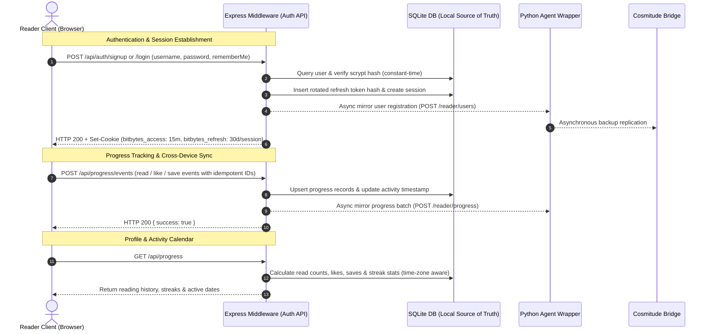

# BitBytes

> Bite-sized computer science and distributed systems notes for B.Tech CS & AI students.
> Dispatched twice daily (03:00 & 15:00 UTC / 8:30 AM & 8:30 PM IST) across Telegram, Git archive, and static web feed.

BitBytes reimagines technical learning for Gen Z students: bite-sized systems engineering notes formatted as a swipeable, social-style conceptual feed. Each note covers real production mechanisms—from kernel protection rings to linear attention in transformers—distilled into 3–5 bite-sized slides with code snippets, diagrams, and primary source provenance.

```
┌────────────────────────────────────────────────────────┐
│                   Reader Clients                       │
│    Mobile & Desktop Web (React / Vite Static PWA)      │
│  - Mandatory Reader Login / Signup Gate                │
│  - Cross-device Progress & Streak Sync                 │
│  - Calendar Activity View & Offline Queue              │
└───────────────┬────────────────────────┬───────────────┘
                │ Reads /feed.json       │ Auth & Progress
                ▼                        ▼
┌───────────────────────────────┐ ┌──────────────────────────────────────┐
│  Static Assets & Archive (GH) │ │         Express Middleware           │
│  frontend/public/feed.json    │ │  - SQLite ACID Store (WAL Mode)      │
│  automation/archive/*.md      │ │  - Scrypt Password Hashing           │
└───────────────▲───────────────┘ │  - Refresh Token Rotation & Families │
                │ Updates feed    │  - Rate Limiting & Lockout Guard     │
┌───────────────┴───────────────┐ └──────────────────┬───────────────────┘
│  Twice-Daily Pipeline (GHA)   │                    │ Async Mirroring
│  Search/RSS/arXiv -> Telegram │                    ▼
│  Social Card Renderer         │ ┌──────────────────────────────────────┐
│  Cosmitude Bridge Telemetry   │ │  Python Agent Wrapper & Cosmitude    │
└───────────────────────────────┘ │  Mirror Storage (/reader/*)          │
                                  └──────────────────────────────────────┘

┌────────────────────────────────────────────────────────┐
│                   Operator Portal                      │
│     Protected Dashboard for Manual Dispatches & Sync   │
│     Separate HMAC Session & Dedicated Passcode Auth    │
└────────────────────────────────────────────────────────┘
```

---

## Reader Accounts & Progress Sync Architecture

BitBytes features a private, cross-device reading tracker for students. Readers authenticate via a privacy-compliant account gate with seamless activity synchronization.



### Storage Decision: Local SQLite + Asynchronous Bridge Mirroring
- **Analysis:** The Cosmitude Bridge operates via a ~10-second polling client loop (`syncUserData` / `clienntSync`) optimized for forum message flows rather than low-latency, transactional CRUD operations. Synchronous auth flows require sub-100ms response times.
- **Implementation:** BitBytes uses **Local SQLite** (`node:sqlite` in WAL mode) as the authoritative, synchronous source of truth for reader credentials, sessions, and activity logs. All user creations, updates, and progress events are asynchronously mirrored to the Python Agent Wrapper (`/reader/users`, `/reader/progress`) and Cosmitude Bridge as a durable backup log.

### Session Management & "Remember Me"
- **Access Tokens:** Short-lived HMAC-SHA256 tokens (15-minute expiration) delivered in `httpOnly`, `Secure` (in production), `SameSite=Lax` cookies (`bitbytes_access`).
- **Refresh Tokens:** Cryptographically random 256-bit entropy tokens, stored strictly as SHA-256 hashes in the database.
  - **With "Remember me" checked:** Refresh cookie expires in **30 days**.
  - **Without "Remember me":** Refresh cookie is a temporary **browser session cookie**.
- **Rotation & Family Revocation:** Refresh tokens rotate on every single exchange (`POST /api/auth/refresh`). If an already-rotated token is reused (indicating token theft or replay), its entire token family is immediately revoked, forcing re-authentication.

### Static `feed.json` Gating Caveat
> [!NOTE]
> `feed.json` and note archives are distributed as static files for high performance, CDN caching, and offline PWA resilience. The reader login modal is a client-side personalization, streak tracking, and engagement gate. It does not provide cryptographic DRM or server-side paywalling of static educational content.

### DPDP Act Compliance & Data Sovereignty
- **Consent:** Explicit consent checkbox acknowledging privacy practices under India's Digital Personal Data Protection (DPDP) Act 2023.
- **Minimal Collection:** No personal identifiable information (PII) required—readers register with a handle and password only.
- **Export My Data:** Complete self-service JSON data export via `GET /api/auth/export-my-data`.
- **Right to Erasure:** Complete account and progress deletion via `DELETE /api/auth/delete-account`, with cascading removal from local SQLite and mirrored deletion upstream.

---

## System Architecture

1. **Automation Pipeline (`automation/`)**:
   - **Cadence:** Dispatched twice daily (03:00 and 15:00 UTC) via GitHub Actions (`.github/workflows/daily_btech_post.yml`).
   - **Discovery:** Firecrawl Search and Hacker News (Algolia single-request front page) in Tier 1, followed by trusted engineering RSS/Atom feeds in Tier 2, and arXiv in Tier 3.
   - **Source Filter:** Whitelisted engineering publications in `automation/sources.json` matched via word-boundary regex and domain matching (`host == d or host.endswith("." + d)`).
   - **Honest Mention Clustering:** Clusters candidate stories by normalized token Jaccard similarity ($\ge 0.5$). `source_count` measures distinct registrable domains over the trailing 7 days. Topics graduate to publication only after independent cross-domain validation.
   - **Grounded LLM Curator:** Uses Gemini (`gemini-flash-lite-latest` with `gemini-3-flash-preview` fallback) to distill teachable systems engineering concepts strictly grounded in fetched articles ($800+$ clean characters, up to 12,000 characters analyzed).
   - **Multi-channel Publishing:** Broadcasts high-resolution 1080x1080 PNG social cards via `sendPhoto` and complete educational lessons via `sendMessage` to Telegram ([@csbites](https://t.me/csbites)), commits YAML front-matter Markdown to `automation/archive/`, and generates `frontend/public/feed.json`.
   - **Evergreen Fallback:** If live discovery exhausts all tiers, rotates through `automation/content_bank/day_*.json` choosing the post posted longest ago or never, complete with canonical engineering references (e.g. RFC 9293).

2. **Cosmitude Bridge Telemetry & Research Reports (`automation/publishers/bridge_reporter.py`)**:
   - **Structured Reports:** Whenever the pipeline runs (whether published, skipped, or failed), a complete structured report is dispatched to Cosmitude Bridge (`BitBytesData_DataProcessing` flow).
   - **Telemetry Fields:** Each report includes the execution timestamp, topic title, curation engine, original source URL, cross-domain source count, publication statuses across Telegram and Git, skipped reason, and lesson summary.
   - **Durable Local Queue:** If Cosmitude Bridge is offline or credentials are missing, reports are persisted to `automation/bridge_queue.json` (gitignored) and automatically flushed when bridge connectivity is restored.

3. **Agent Wrapper (`agent/wrapper/agent_server.py`)**:
   - Hardened HTTP server exposing `/health`, `/requests`, and `/broadcast`. Runs on `AGENT_HOST` (`127.0.0.1`) and `AGENT_PORT` (`5001`).
   - Protects non-health routes with constant-time `hmac.compare_digest` checking against `X-Agent-Key`.
   - Rejects request payloads larger than 64 KB with HTTP 413.
   - Concurrency control: `POST /broadcast` acquires a `threading.Lock` and returns HTTP `202 Accepted` with a UUID `jobId`, or `409 Conflict` if a job is active. Thread creation errors safely release the lock.
   - Asynchronous job telemetry: Polled via `GET /broadcast/status/<jobId>` with UUID format validation.
   - Thread-safe storage: In-memory job and request stores guarded by `threading.Lock`.

4. **Middleware (`middleware/`)**:
   - Express API gateway with security headers (`X-Content-Type-Options: nosniff`, `X-Frame-Options: DENY`, `Referrer-Policy: strict-origin-when-cross-origin`, `Cache-Control: no-store` on `/api/*`).
   - Fail-fast validation: Server exits immediately (`process.exit(1)`) if `OPERATOR_PASSCODE` or `OPERATOR_TOKEN_SECRET` is missing.
   - Reverse proxy support: Configurable via `TRUST_PROXY` env var (default disabled).
   - Operator login (`POST /api/operator/login`): rate-limited to 5 attempts per minute per IP (with automatic periodic memory pruning), constant-time `crypto.timingSafeEqual` passcode verification, and signs 8-hour HMAC tokens.
   - Protected routes guarded by `requireOperator` middleware.

5. **Frontend (`frontend/`)**:
   - Built with React and Vite following strict Ponytail minimalism (flat surfaces, 1px hairline borders, single accent color, no gradients or glows, self-hosted IBM Plex Sans and JetBrains Mono Latin woff2 fonts, zero external font requests).
   - Asymmetric layout: Dominant latest dispatch card and compact archive rows.
   - Note detail view at `#p/<id>` with one-click code copy, source provenance chip, and breadcrumb navigation.
   - Single `<main>` on every page, full `:focus-visible` states, and `prefers-reduced-motion` compliance.

---

## Environment Variables

### 1. Automation Pipeline (`automation/.env`)
| Variable | Description | Default / Example |
|---|---|---|
| `TELEGRAM_BOT_TOKEN` | Bot token from @BotFather | Required for live broadcast |
| `TELEGRAM_CHANNEL_ID` | Telegram channel username or ID | `@csbites` |
| `GEMINI_API_KEY` | Google Gemini API key | Required for LLM curation |
| `GEMINI_MODEL` | Primary Gemini model identifier | `gemini-flash-lite-latest` |
| `GEMINI_MODEL_FALLBACK` | Fallback Gemini model identifier | `gemini-3-flash-preview` |
| `FIRECRAWL_API_KEY` | Firecrawl scraping API key | Optional (falls back to direct HTTP) |
| `USE_AI_RADAR` | Enable autonomous live web research | `true` |
| `GENERATE_IMAGE` | Render 1080x1080 PNG social card | `true` (production default) |
| `SIMULATE_MODE` | Dry-run mode for local testing | `false` |

### 2. Agent Wrapper (`agent/.env`)
| Variable | Description | Default / Example |
|---|---|---|
| `AGENT_HOST` | Host address to bind | `127.0.0.1` |
| `AGENT_PORT` | Port for agent server | `5001` |
| `AGENT_API_KEY` | Secret key required in `X-Agent-Key` header | Set strong random secret |
| `TELEGRAM_CHANNEL` | Public channel name for Cosmitude bridge log | `@csbites` |
| `COSMITUDE_API_BASE` | Cosmitude API Base URL | `https://ca.cosmitude.com` |
| `COSMITUDE_MAC_ADDRESS` | Bridge device identifier | `Bridge-Web` |
| `COSMITUDE_USERNAME` | Cosmitude Bot UUID | Required for Cosmitude Bridge |
| `COSMITUDE_PASSWORD` | Cosmitude Bot Password | Required for Cosmitude Bridge |
| `COSMITUDE_SERVER_ID` | Cosmitude LLServer ID | Required for Cosmitude Bridge |
| `COSMITUDE_FORUM_ID` | Cosmitude Forum ID | Required for Cosmitude Bridge |

### 3. Middleware (`middleware/.env`)
| Variable | Description | Default / Example |
|---|---|---|
| `PORT` | Middleware HTTP port | `4000` |
| `AGENT_URL` | Upstream Agent URL | `http://127.0.0.1:5001` |
| `AGENT_API_KEY` | Must match `AGENT_API_KEY` in `agent/.env` | Shared secret |
| `OPERATOR_PASSCODE` | Passcode for operator console login | Required (no fallback) |
| `OPERATOR_TOKEN_SECRET` | Secret key used to sign HMAC tokens (8h) | Required (no fallback) |
| `USER_TOKEN_SECRET` | Secret key used to sign reader session tokens | 32+ character random string |
| `COOKIE_DOMAIN` | Optional cookie domain for subdomains | Empty (host-only) |
| `DATABASE_PATH` | Path to persistent SQLite database | `data/bitbytes.db` |
| `TRUST_PROXY` | Enable reverse proxy IP resolution | `false` |
| `FRONTEND_ORIGIN` | Allowed CORS origins (comma-separated) | `http://localhost:5180` |

### 4. Frontend (`frontend/.env`)
| Variable | Description | Default / Example |
|---|---|---|
| `VITE_API_BASE` | Base URL for middleware API requests | `""` (proxied by Vite) |

---

## Local Development Quickstart

### Prerequisites
- **Node.js:** `>= 18`
- **Python:** `3.11` (pinned via `.python-version` to match CI runner runtime)

### 1. Install Dependencies
```bash
# Frontend
cd frontend && npm install

# Middleware
cd ../middleware && npm install

# Automation (Python 3.11)
cd ../automation && pip install -r requirements.txt -r requirements-dev.txt

# Agent
cd ../agent && pip install -r requirements.txt
```

### 2. Run Test Suites
```bash
# Frontend component & build checks
cd frontend && npm run build

# Middleware operator & reader authentication tests
npm --prefix middleware test

# Automation pipeline tests (with dummy Cosmitude credentials)
$env:COSMITUDE_USERNAME='d'; $env:COSMITUDE_PASSWORD='d'; $env:COSMITUDE_SERVER_ID='d'; $env:COSMITUDE_FORUM_ID='d'; python -m pytest automation/tests -q
```

### 3. Dry-Run the Pipeline Locally
```bash
python automation/main.py --dry-run
```

### 4. Start Local Services
- **Terminal 1 (Agent Wrapper):**
  ```bash
  cd agent/wrapper && python agent_server.py
  ```
- **Terminal 2 (Middleware):**
  ```bash
  cd middleware && npm run dev
  ```
- **Terminal 3 (Frontend):**
  ```bash
  cd frontend && npm run dev
  ```

Open [http://localhost:5180](http://localhost:5180) in your browser.

---

## Troubleshooting Guide

| Issue | Symptoms | Root Cause | Resolution |
|---|---|---|---|
| **CI step 5 fails with exit code 1** | Pytest fails at `test_send_record_payload_keys` in ~16s | `BitBytesData_*.txt` is gitignored; absent on clean CI runner | Resolved via bundled `agent/BitBytesData_Admin_fallback.json` fallback schema. |
| **Node 20 deprecation warning** | Warning on `actions/checkout` or `actions/setup-python` | GitHub Actions runner deprecating Node 20 | Set `env: FORCE_JAVASCRIPT_ACTIONS_TO_NODE24: 'true'` at workflow level. |
| **Operator login returns 401** | `Invalid operator passcode` | `OPERATOR_PASSCODE` in `middleware/.env` does not match input | Verify and match passcode in `middleware/.env`. |
| **Middleware returns 503** | `Cosmitude Agent is unavailable` | Agent wrapper not running or wrong `AGENT_URL` | Start `python agent/wrapper/agent_server.py` and ensure `AGENT_URL=http://127.0.0.1:5001`. |
| **Telegram broadcast skipped** | Pipeline logs `Telegram skipped` | `TELEGRAM_BOT_TOKEN` or `TELEGRAM_CHANNEL_ID` empty | Configure repository secrets in GitHub Settings → Secrets and variables → Actions. |
| **Social card font failure** | Infographic image text rendering error | TTF fonts not found in system paths | The repository bundles `DejaVuSans.ttf` and `DejaVuSansMono.ttf` under `automation/assets/fonts/`. |

